  

###

  
  
  
  
  

###

  

###

<h1 data-importer="text" align="center">🙌 Simple is Beauty 👋</h1>

###

<h3 data-importer="text" align="left">👩‍💻  About Me</h3>

###

I'm Rakyma.  - 🔭 I’m working as software engineer.  - 📚 I'm currently learning AI. - ⚡ In my free time I enjoy chatting with random one.

###

<h3 data-importer="text" align="left">🛠 Language and tools</h3>

###

  
  
  
  
  
  
  
  
  
  
  
  
  
  
  
  
  
  
  
  
  
  
  
  
  
  
  
  
  
  
  
  
  
  
  
  
  
  
  
  
  
  
  
  
  
  
  
  
  
  
  
  
  
  
  
  
  
  
  
  
  
  
  
  
  
  
  
  
  
  
  
  
  
  
  
  
  
  
  
  
  
  
  
  
  
  
  
  
  
  
  
  
  
  
  
  
  

###

<h3 data-importer="text" align="left">🔥   My Stats :</h3>

###

  <!--  -->
  

###
